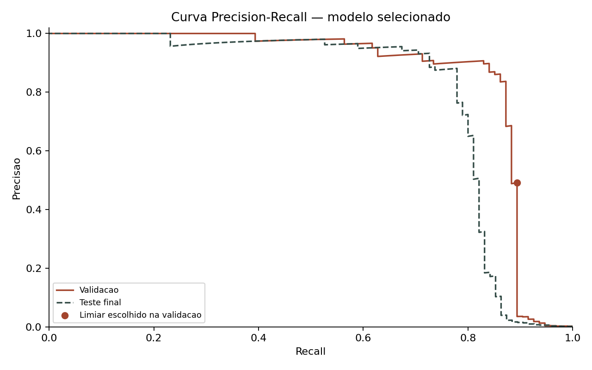
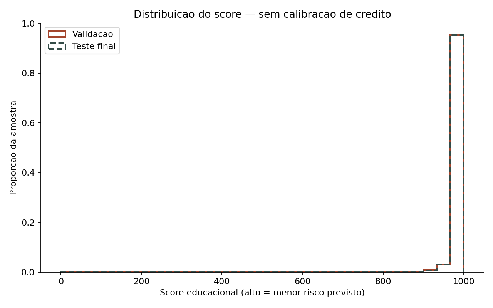
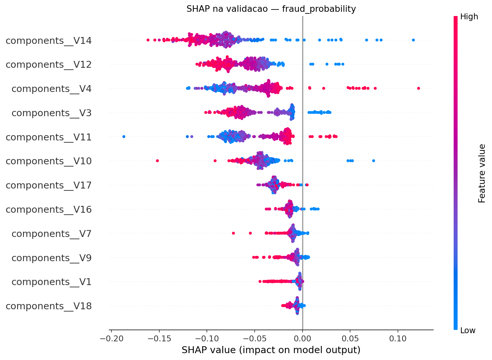
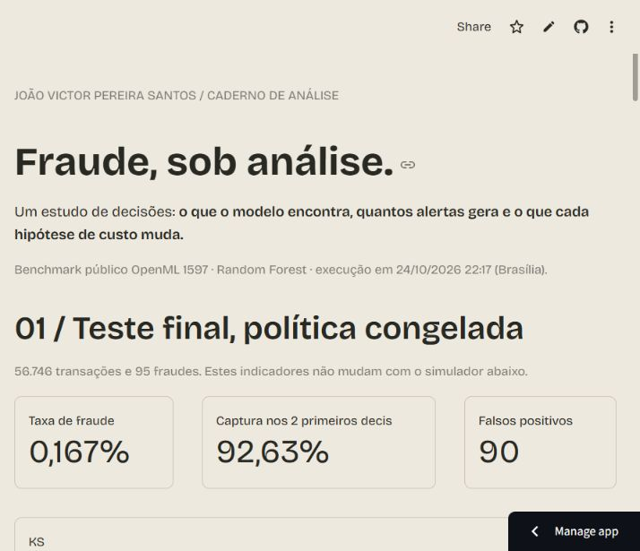

# Detecção de fraude: do modelo à decisão

Estudo educacional de **João Victor Pereira Santos**, iniciado no Bootcamp Santander 2026 / DIO e evoluído para um experimento reproduzível de classificação de fraude. Usa o benchmark público de transações de cartão; não utiliza dados, modelos ou políticas da Serasa Experian.

[Dashboard público](https://joaovictor-fraud-analytics.streamlit.app/) · [Estudo de caso no portfólio](https://joaovictor-portfolio-five.vercel.app/estudo-fraude.html) · [Relatório original](outputs/metrics_report.json) · [Consultas SQL](sql/queries_analiticas.sql)

## Problema de negócio

Como identificar fraudes sem gerar um volume impraticável de alertas? Acurácia isolada não responde a essa pergunta em uma base desbalanceada. O estudo compara classificadores e escolhe uma política considerando captura, falsos positivos e **custos explicitamente hipotéticos**.

## Dados e execução

- Fonte: [OpenML 1597 — creditcard](https://www.openml.org/search?type=data&id=1597), espelho do benchmark ULB/Worldline.
- Base original: 284.807 transações e 492 fraudes.
- Após remover 1.081 duplicatas exatas: 283.726 transações e 473 fraudes.
- Execução de referência: **24/10/2026 22:17**, horário de Brasília; semente **42**.
- O ARFF é verificado contra o checksum publicado; a coluna `Time` original é preservada, mesmo sendo marcada como identificador de linha no OpenML.
- Hash SHA-256 do CSV processado como entrada: `895dc3dad2840ac9e05c12d6442bd739d879c2d405e9b065efc0f1973be46a84`.

## Da v1 à v2: correção metodológica

Na [v1](https://github.com/JVZerinho/Deteccao_Anomalias_Transacoes_Python/blob/dd6d69c45b5af4c6c8615d1eba8e29251cf7bad3/desafio.py), o escalonamento era ajustado na base completa e o conjunto de teste era usado para escolher o limiar. Esses procedimentos foram corrigidos na v2:

1. Verificações de esquema, tipos, valores ausentes, infinitos, duplicatas, conflitos de rótulo e consistência temporal.
2. Deduplicação determinística antes da divisão, evitando cópias idênticas em conjuntos diferentes.
3. Divisão estratificada **60/20/20** antes do ajuste das transformações: treino com 170.235 linhas, validação com 56.745 e teste com 56.746.
4. `Pipeline` + `ColumnTransformer`: `RobustScaler.fit` somente no treino; validação e teste recebem apenas transformações. O código verifica o centro do scaler contra a mediana do treino.
5. Regressão logística, Random Forest e XGBoost treinados somente no treino. Modelos e limiares comparados exclusivamente na validação.
6. Escolha congelada; somente o modelo selecionado produz probabilidades para a avaliação final do teste. Não há retreino com a validação após a escolha.
7. SHAP calculado em uma amostra da validação; limites das faixas de score definidos no treino.

Os números da v1 foram substituídos pelos artefatos da execução v2. As versões não constituem uma comparação causal de desempenho: protocolo, divisão e base após deduplicação mudaram.

## Comparação na validação

Cada modelo usa seu limiar escolhido na validação. Critério: menor custo simulado total; desempate por menos alertas, maior AP e nome do modelo. Dentro de cada modelo, empates de custo favorecem menos alertas e maior limiar.

| Modelo | Limiar | Recall | Precisão | AP | Custo hipotético total |
| --- | ---: | ---: | ---: | ---: | ---: |
| Random Forest | 0,204564 | 89,36% | 49,12% | 0,8571 | 5.855,00 |
| XGBoost | 0,561674 | 89,36% | 40,19% | 0,7908 | 6.045,00 |
| Regressão logística | 0,981674 | 88,30% | 52,87% | 0,7872 | 6.285,00 |

**Modelo selecionado: Random Forest**, limiar `0.204563648219`. A escolha vale para este cenário, não significa superioridade universal.

Hipóteses de referência: revisão por alerta = **5,00 u.m.**; fraude não detectada = **500,00 u.m.**. Fórmula: `revisão × (TP + FP) + fraude não detectada × FN`. Todo alerta demanda revisão. Esses valores não são custos de um banco nem economia financeira comprovada.

## Resultado no teste reservado

| Indicador | Resultado |
| --- | ---: |
| Transações | 56.746 |
| Fraudes reais | 95 |
| Verdadeiros positivos (TP) | 78 |
| Falsos positivos (FP) | 90 |
| Falsos negativos (FN) | 17 |
| Verdadeiros negativos (TN) | 56.561 |
| Recall | 82,11% |
| Precisão | 46,43% |
| F1 | 0,5932 |
| Average precision (AP) | 0,7926 |
| PR-AUC trapezoidal | 0,7923 |
| ROC-AUC | 0,9530 |
| KS | 0,8507 |
| Gini | 0,9060 |
| Captura nas duas primeiras faixas | 92,63% |
| População nas duas primeiras faixas | 20,28% |

O modelo detectou **78 das 95 fraudes**, com **90 falsos positivos** e **17 fraudes não detectadas**. AP e PR-AUC trapezoidal são calculadas separadamente. O relatório contém todos os valores com precisão numérica original.



## Score, decis e estabilidade

O score educacional é `1000 × (1 − p_fraude)`: score maior significa menor risco previsto. Não é score Serasa, score de crédito calibrado ou probabilidade de inadimplência. Os modelos usam pesos de classe e suas probabilidades não foram calibradas.

As nove fronteiras de quantis vêm do **treino**. Decil de risco 1 reúne menores scores e maior risco. Empates são preservados; faixas podem ter tamanhos diferentes ou ficar vazias. As duas primeiras faixas capturam **92,63%** das fraudes e abrangem **20,28%** das transações do teste.

| Decil de risco | Intervalo de score* | Transações | Fraudes | Captura | Captura acumulada | População acumulada |
| --- | --- | ---: | ---: | ---: | ---: | ---: |
| 1 | 0,000 a 980,371 | 5.741 | 86 | 90,53% | 90,53% | 10,12% |
| 2 | 980,371 a 989,395 | 5.766 | 2 | 2,11% | 92,63% | 20,28% |
| 3 | 989,395 a 993,521 | 5.735 | 3 | 3,16% | 95,79% | 30,38% |
| 4 | 993,521 a 995,907 | 5.759 | 0 | 0,00% | 95,79% | 40,53% |
| 5 | 995,907 a 997,293 | 5.680 | 0 | 0,00% | 95,79% | 50,54% |
| 6 | 997,293 a 998,102 | 5.564 | 1 | 1,05% | 96,84% | 60,35% |
| 7 | 998,102 a 998,625 | 5.499 | 0 | 0,00% | 96,84% | 70,04% |
| 8 | 998,625 a 999,023 | 5.731 | 1 | 1,05% | 97,89% | 80,14% |
| 9 | 999,023 a 999,354 | 5.609 | 1 | 1,05% | 98,95% | 90,02% |
| 10 | 999,354 a 1.000,000 | 5.662 | 1 | 1,05% | 100,00% | 100,00% |

*Intervalos arredondados nesta tabela. Limite inferior inclusivo e superior exclusivo; última faixa inclui 1000. Use os limites completos em [score_deciles.csv](outputs/score_deciles.csv).

- **KS:** máximo absoluto da diferença entre TPR e FPR.
- **Gini:** `2 × ROC_AUC − 1`.
- **PSI validação → teste:** **0,000160**, usando limites do treino e pseudocontagem de 0,5 por faixa. É comparação entre amostras aleatórias, não evidência de drift temporal ou monitoramento em produção.



## Interpretação com SHAP

O gráfico explica uma amostra de 300 observações da validação. Para o modelo selecionado, a unidade registrada é `fraud_probability`. SHAP mostra associações do modelo, não causalidade. V1–V28 são componentes PCA anônimos e não podem ser interpretados como renda, idade ou limite de crédito.



## SQL analítico

O [arquivo SQL completo](sql/queries_analiticas.sql) contém esquema e quatro análises; o [carregador](sql/carregar_e_consultar.py) importa previsões com comandos parametrizados:

1. `GROUP BY` e `CASE WHEN`: taxa de fraude por faixa de valor e hora relativa, valor fraudulento observado e custos simulados.
2. Funções de janela: média das últimas dez transações, `LAG` e alertas acumulados por conjunto.
3. CTEs e JOINs: falsos positivos de alto valor na política original. Com limite hipotético de 1.000, a execução de referência retorna zero linhas; não há dados fictícios nos resultados.
4. Coorte por dia relativo de transação. Não é safra de originação ou maturação de crédito.

As quatro consultas foram executadas em SQLite e PostgreSQL 18.6 via PGlite, sobre 113.491 transações, com valores equivalentes e reconciliação independente em Pandas. A conexão psycopg a servidor PostgreSQL nativo não foi exercitada. A base não oferece ID de cliente/cartão; as janelas são globais por conjunto. `Time` não é horário civil e valor fraudulento não é perda realizada.

## Dashboard

**[Abrir o dashboard público](https://joaovictor-fraud-analytics.streamlit.app/)**

O dashboard lê o relatório e as previsões desta execução. Os KPIs iniciais são do teste final e permanecem congelados. O simulador usa **somente validação**, com limiar e hipóteses de custo ajustáveis, sem treinar ou selecionar novos modelos. As previsões compactadas são conferidas contra o hash do CSV original antes de exibir números.



## Instalação e execução completas

Use **Python 3.12**. Clone o repositório e entre na pasta:

```bash
git clone https://github.com/JVZerinho/Deteccao_Anomalias_Transacoes_Python.git
cd Deteccao_Anomalias_Transacoes_Python
```

Windows PowerShell:

```powershell
py -3.12 -m venv .venv
.\.venv\Scripts\python.exe -m pip install -r requirements.txt
.\.venv\Scripts\python.exe -m pip install -r requirements-dashboard.txt
.\.venv\Scripts\python.exe -m pip check
.\.venv\Scripts\python.exe -m unittest -v test_metodologia
.\.venv\Scripts\python.exe -m unittest discover -s tests -v
.\.venv\Scripts\python.exe -m streamlit run dashboard/app_dashboard.py
```

Linux/macOS:

```bash
python3.12 -m venv .venv
.venv/bin/python -m pip install -r requirements.txt -r requirements-dashboard.txt
.venv/bin/python -m pip check
.venv/bin/python -m unittest -v test_metodologia
.venv/bin/python -m unittest discover -s tests -v
.venv/bin/python -m streamlit run dashboard/app_dashboard.py
```

Para abrir o dashboard e executar SQL, basta instalar `requirements-dashboard.txt`: os artefatos verificados acompanham o repositório. O modelo serializado e a base original não são necessários para a aplicação.

Para gerar um **novo experimento**, preservando o resultado publicado, instale `requirements.txt` e use outro diretório de saída:

```bash
python desafio.py --openml-id 1597 --output-dir outputs-nova-execucao
```

Ou forneça CSV com exatamente `Time`, `V1`–`V28`, `Amount`, `Class`:

```bash
python desafio.py --data data/creditcard.csv --source-note "Origem e versão do CSV" --output-dir outputs-nova-execucao
```

Custos são parâmetros de validação: `--review-cost 5 --missed-fraud-cost 500`. Não escolha novos parâmetros em resposta ao desempenho do teste. O programa recusa saída não vazia para não misturar execuções. O download original não é redistribuído e o antigo Dropbox não é necessário.

Para carregar e consultar SQLite:

```bash
python sql/carregar_e_consultar.py --engine sqlite
```

Para PostgreSQL, defina `DATABASE_URL` no ambiente local ou no serviço de segredos e use `--engine postgres`. Não coloque credenciais no código. Mais detalhes em [EXECUCAO_MODULO_3.md](EXECUCAO_MODULO_3.md).

## Artefatos e rastreabilidade

- [metrics_report.json](outputs/metrics_report.json): origem, hashes, ambiente, hipóteses, divisão, seleção e métricas.
- [score_deciles.csv](outputs/score_deciles.csv): faixas e captura de validação/teste.
- `outputs/predictions.csv.gz`: previsões de validação/teste, sem treinamento no início do dashboard; a leitura confere o hash do conteúdo descompactado.
- [SQL, interface e reconciliação](VALIDACAO_MODULO_3.json); [verificação metodológica](VALIDACAO_MODULO_2.json).
- Gerador desta documentação: `scripts/sincronizar_documentacao.py --dashboard-url URL_PUBLICADA`; os números são derivados do JSON/CSV, não digitados como estimativas.

Não carregue pipelines `joblib` de terceiros. O dashboard utiliza apenas JSON, CSV/GZip e imagens geradas pelo projeto.

## Limitações reais

Divisão aleatória não mede generalização futura; não há isolamento por cliente/cartão verificável. A PCA foi fornecida pronta e não há acesso ao seu ajuste original. O teste contém apenas 95 fraudes, sem intervalo de confiança implementado. O score não foi calibrado, custos são hipóteses e não há impacto financeiro real ou implantação de modelo em produção demonstrados. Nenhuma métrica é automaticamente transferível para dados da Serasa Experian.

